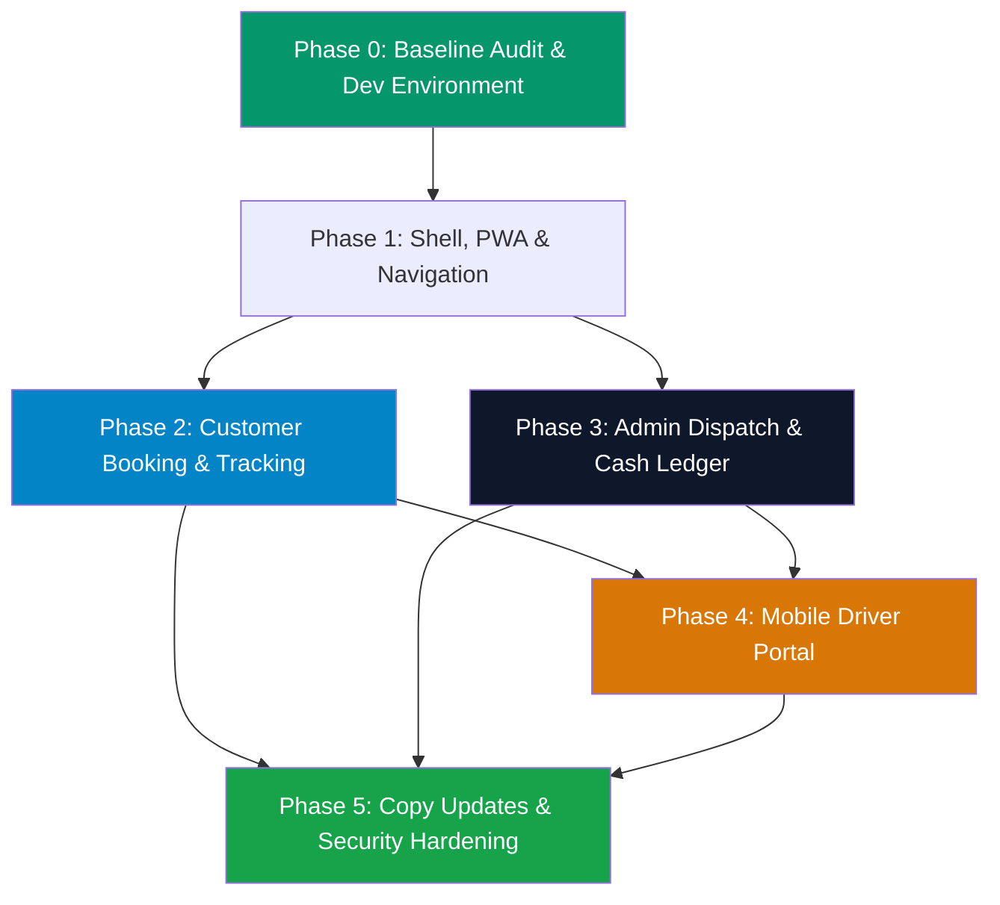

# Droovee Application Upgrade — Streamlined Master Execution Plan

> **Scope Adjustment:** **OTP SMS, SMTP Email, and Online Payment Gateway are skipped for now.**
> **Authentication:** Dev/Mock OTP mode & standard password authentication.
> **Payments:** Cash paid to driver & manual staff/admin recording.
> **Notifications:** In-app status timeline, toast notifications, and console/audit logging.
> **Sources:** [Droovee_Application_Upgrade_Blueprint.pdf](file:///e:/DROOVEE/Droovee_Application_Upgrade_Blueprint.pdf) & [changes and issues.txt](file:///e:/DROOVEE/changes%20and%20issues.txt)
> **Codebase:** [droovee-api](file:///e:/DROOVEE/droovee-api) | [droovee-web](file:///e:/DROOVEE/droovee-web)

---

## 🎯 Key Directives & Business Rules

1. **Brand Identity:** Preserve Droovee palette (#0F172A navy/slate, #059669 emerald, #F8FAFC light surface) and existing logo.
2. **Text & Copy Updates ([changes and issues.txt](file:///e:/DROOVEE/changes%20and%20issues.txt)):**
   - In "How it works", remove `"salaried"` from the driver assignment description.
   - Clarify customer responsibilities: Toll, parking, fuel, and driver food/stay/return (for outstation).
   - Clarify driver responsibility: Damage to the vehicle while driving.
3. **Booking Separation:**
   - Keep **Fast/Guest Booking** and **Signed-in Booking** strictly separated.
   - When a logged-in user clicks "Book", route them to the authenticated booking flow (do NOT redirect to guest form).
   - Fast booking displays an explicit note: *"Please note down your Booking ID for future reference and tracking."*
4. **Tracking Flexibility:**
   - Tracking can be performed using **Mobile Number** OR **Booking ID**.
5. **Forgot Password:**
   - Add "Forgot Password" on the user sign-in page with dev/local OTP or direct reset link.

---

## 🏗️ Phase 0 — Baseline Audit & Local Stability (P0)

> **Goal:** Validate local environment, ensure tests pass with dev flags, and apply immediate security/data hygiene fixes.

### Tasks
- [ ] **0.1 Environment Configuration:**
  - Ensure `droovee-api/.env` has `OTP_ENABLED=false` or `OTP_DEBUG=true` (fixed dev code like `123456` or console output).
  - Configure dummy/silent notification transport so missing SMTP credentials do not fail booking flows.
- [ ] **0.2 Run API & Web Builds:**
  - `droovee-api`: verify TypeScript compilation & run tests (`npm test`).
  - `droovee-web`: verify Next.js build & typecheck.
- [ ] **0.3 Immediate Security/PII Fixes (from [FIXES.md](file:///e:/DROOVEE/FIXES.md)):**
  - **DR-SEC-001:** Sanitize public tracking endpoint (`GET /api/v1/bookings/track`) so phone-only queries do not leak sensitive PII or raw `shareToken`.
  - **DR-SEC-002:** Driver upload security: randomize filename (`uuid.jpg`) and validate MIME/magic bytes.
  - **DR-SEC-005:** Next.js route protection middleware for `/admin/*` and future `/driver/*`.

> **Exit Gate 0:** Clean builds, tests passing locally with mock OTP/silent notifications, critical PII leaks closed.

---

## 🎨 Phase 1 — Shared App Shell, Design System & PWA

> **Goal:** Create an installable mobile-first PWA foundation without modifying the backend.

### Tasks
- [ ] **1.1 Design System & Component Library:**
  - Standardize emerald (`#059669`) / slate (`#0F172A`) tokens across cards, inputs, buttons, badges, modals, and tables.
  - Update [PublicShell.tsx](file:///e:/DROOVEE/droovee-web/src/components/PublicShell.tsx) with a responsive mobile navigation bar / bottom tab navigation.
- [ ] **1.2 PWA Implementation:**
  - Create `manifest.json` (Droovee branding, emerald theme color, standalone display).
  - Implement service worker for static shell caching (strictly bypass API, booking, and auth routes).
  - Add non-intrusive "Install Droovee App" prompt on mobile browsers.
  - Add friendly offline fallback screen.
- [ ] **1.3 Role-Aware Layouts:**
  - Customer shell (`/`, `/book/*`, `/bookings/*`, `/account/*`).
  - Admin shell ([AdminShell.tsx](file:///e:/DROOVEE/droovee-web/src/components/AdminShell.tsx)) with responsive drawer for mobile/tablet.
  - Driver portal shell (`/driver/*`).

> **Exit Gate 1:** Web app installable as PWA on Android/Desktop with seamless responsive navigation.

---

## 📱 Phase 2 — Customer Experience & Booking Flows

> **Goal:** Replicate reference-video customer flows: adaptive booking, route preview, price breakdown, and account history.

### Tasks
- [ ] **2.1 Authentication & Forgot Password:**
  - Sign In page: support both Password and Phone + dev OTP (displays OTP on screen in dev mode for testing).
  - Add **Forgot Password** flow on the login page ([forgot-password/page.tsx](file:///e:/DROOVEE/droovee-web/src/app/forgot-password/page.tsx)) using password-reset token or dev OTP.
- [ ] **2.2 Separate Booking Paths ([changes and issues.txt](file:///e:/DROOVEE/changes%20and%20issues.txt)):**
  - **Signed-in Booking ([/book/user](file:///e:/DROOVEE/droovee-web/src/app/book/user/page.tsx)):** Pre-fills user details, links directly to account trip history.
  - **Fast / Guest Booking ([/book](file:///e:/DROOVEE/droovee-web/src/app/book/page.tsx)):** Standalone guest form. Displays persistent notice: *"Important: Note down your Booking ID (#DRV-XXXX) to track your driver status."*
- [ ] **2.3 Service-Adaptive Booking Journey:**
  - **Service Selector:** Hourly, Half-day, Full-day, Monthly office, Outstation, Station/Airport pickup.
  - **Dynamic Forms:**
    - *Hourly / Half-day / Full-day:* Duration, start time.
    - *Outstation:* One-way vs Round-trip toggle, dates, night-halt.
    - *Monthly:* Schedule, pickup/drop days & times.
    - *Airport/Station:* Terminal / Stop drop.
  - **Vehicle details:** Make/model & Transmission (Manual / Automatic).
  - **Location & Route Preview:** Pickup & drop autocomplete (with fallback manual input) + route summary.
  - **Transparent Fare Estimate:** Display base package, additional hours (₹89/hr), night surcharge (₹99 for 10PM–6AM), launch coupon `LAUNCH99`.
  - **Customer Responsibilities Disclosure:** Clearly display checkboxes/notes for Toll/Parking/Fuel & Outstation Food/Stay.
- [ ] **2.4 Tracking & History:**
  - Enhance [/track](file:///e:/DROOVEE/droovee-web/src/app/track/page.tsx) to query by **Booking ID** OR **Mobile Number**.
  - Customer booking history & status timeline (`requested` → `confirmed` → `driver_assigned` → `driver_on_the_way` → `in_progress` → `completed`).
  - Self-service cancellation request within allowed states.

> **Exit Gate 2:** Users can book via guest or authenticated flows, view fare estimates, and track bookings seamlessly.

---

## 🛠️ Phase 3 — Admin & Operations Dispatch Console

> **Goal:** Complete and polish all 9 admin management modules.

### Tasks
- [ ] **3.1 Dispatch & Booking Management:**
  - Real-time booking queue with status filter, service filter, and search.
  - Manual driver assignment with **conflict detection & warning** (with recorded admin override reason).
  - Driver contact confirmation logging (`not_contacted`, `contacted`, `confirmed`, `declined`, `unreachable`).
  - Booking detail modal/page: fare adjustments with mandatory reason log.
- [ ] **3.2 Driver & Availability Management:**
  - Driver roster with contact info, vehicle transmission capabilities, active status.
  - Visual driver availability & leave/block calendar.
- [ ] **3.3 Cash Payment Recording (No Gateway Needed):**
  - Record cash collection by driver or staff (amount, received by, receipt notes, date/time).
  - Payment ledger reflects `cash_collected`, `pending`, or `waived`.
- [ ] **3.4 Settings & Pricing Engine:**
  - Admin UI to update base fares, extra hour rates, night charges, and coupons.
- [ ] **3.5 Support Tickets, Customer Management & Audit Log:**
  - Support ticket inbox (categorize, assign, resolve).
  - Searchable audit log capturing every booking status change, assignment, and fare modification with actor ID and timestamp.

> **Exit Gate 3:** Admin can receive bookings, check driver conflicts, assign drivers, log calls, update statuses, and record cash payments.

---

## 🚗 Phase 4 — Mobile-First Driver Portal

> **Goal:** Provide drivers with a clean, focused mobile interface for their assigned trips.

### Tasks
- [ ] **4.1 Driver Authentication & Session:**
  - Driver phone/password or secure trip link login.
  - Strictly limit driver scope: driver can **only** view trips assigned to them.
- [ ] **4.2 Trip Execution Workflow:**
  - **Assigned Trip View:** Customer pickup address, drop address, scheduled time, customer contact button (Call/WhatsApp), special instructions.
  - **Status Transitions:** Buttons to advance trip milestone:
    `Acknowledge/Confirm` → `Driver on the Way` → `Start Trip (In Progress)` → `Complete Trip`.
  - Display trip verification code on screen (no email needed).
- [ ] **4.3 Cash Collection Recording:**
  - Driver marks "Cash Collected: ₹XYZ" upon trip completion.
- [ ] **4.4 Schedule & Leave View:**
  - Driver can view upcoming schedule and submit unavailable/leave requests.

> **Exit Gate 4:** Driver can log in on mobile, see assigned trips, update milestones in real time, and record cash collections.

---

## 🔒 Phase 5 — Security, Edge Cases & Copy Updates

> **Goal:** Apply business copy changes and enforce security boundaries.

### Tasks
- [ ] **5.1 Content & Marketing Copy ([changes and issues.txt](file:///e:/DROOVEE/changes%20and%20issues.txt)):**
  - Remove `"salaried"` from the "How it works" section on the homepage.
  - Update FAQ and Terms: Driver is responsible for driving damages; Customer is responsible for toll/parking/fuel/food/stay.
  - Align homepage arrival claims to realistic operational language.
- [ ] **5.2 Security Hardening (from [FIXES.md](file:///e:/DROOVEE/FIXES.md)):**
  - **DR-SEC-003:** Hash `shareToken` in DB (`shareTokenHash`).
  - **DR-SEC-007:** MongoDB transactional booking creation for concurrency safety.
  - **DR-SEC-008:** Restrict sensitive business/pricing endpoints to authorized roles.
  - **DR-SEC-011:** Secure HTTP headers (CSP, X-Content-Type-Options: nosniff).
- [ ] **5.3 Test Suite & Local Validation:**
  - Run regression test suite covering status machine, conflict checks, and RBAC permissions.

> **Exit Gate 5:** Copy matches owner instructions, security items resolved, all tests passing.

---

## 📋 Summary of Skipped Integrations & Alternatives

| Feature | Production Requirement | For Now (Simplified Alternative) |
|---------|------------------------|----------------------------------|
| **SMS OTP** | DLT-registered SMS Gateway (Twilio/Fast2SMS/Msg91) | **Dev/Mock OTP:** Pre-filled or displayed on screen (`123456`) / console log + password login. |
| **Email SMTP** | Production transactional email (SendGrid/SES/SMTP) | **In-App / Console:** Booking confirmation displayed on confirmation screen + Booking ID note. |
| **Payment Gateway**| Razorpay / Cashfree UPI & Card checkout | **Cash to Driver & Manual Ledger:** Cash collection recorded by driver/admin with receipt records. |

---

## 🚀 Execution Sequence

Please review this streamlined plan. Once you confirm, we will begin immediately with **Phase 0 & Phase 1**!
